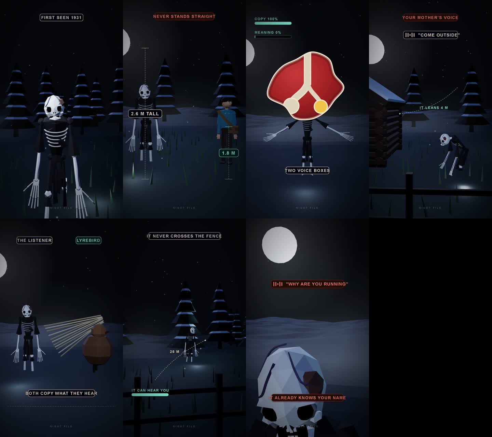

# The monster introduction block (engine v0.6)

A 25–40 s "creature file" segment, built from the reference monster short. It can open a
Reel, or sit straight after the teaser in the long video. Sets live in `src/MI3.tsx`,
the HUD vocabulary in `src/k3/Hud3.tsx`.

Render the reference sheet to see all seven cards:

```bash
npx remotion render build MISheet qa/mi.mp4 --gl=angle     # 9:16, one frame per card
npx remotion render build MISheetL qa/mi_l.mp4 --gl=angle  # 16:9
```



## The seven cards, in order

| Set | Question it answers | What is on screen |
|---|---|---|
| `mi_reveal` | What is it? | half-hidden between two trunks, the name pill lands |
| `mi_height` | How big? | full body on clean ground, a person beside it, both measured |
| `mi_anatomy` | What is inside? | the creature dim behind, the red cutaway panel in front |
| `mi_ability` | What does it do? | it bends toward a lit window, the stolen voice plays |
| `mi_compare` | What is it like? | beside one real animal the viewer already knows |
| `mi_scale` | How close? | a person at the fence, the creature at a measured distance |
| `mi_threat` | Why do you lose? | head and shoulders, close enough to see the teeth |

Keep every card under 5 s. Never show a card twice without changing **both** the camera
and the annotation — a repeated picture is a fail even when it is a good picture.

## The creature is always the story's creature

These sets supply **framing and HUD only**. `v.c` names an entry in `CREAT3`, built from
`story/creature.md`. Quality law 4a still holds: the monster is the story's monster, drawn
from the story's words, never a stock monster carried between videos.

## Wording comes from the scene table, never from the set

Every label, number and quote is passed through `v`, so the block says what the story says:

```python
('mi_anatomy', {
    'panel': 'voice',                       # voice | mind | mirror | heat | gut
    'meters': [{'t': 'COPY 100%', 'v': 1.0},
               {'t': 'MEANING 0%', 'v': 0.02}],
    'facts': [{'t': 'TWO VOICE BOXES', 'at': [0.5, 0.78], 'in': 0.9}],
}),
('mi_height', {'tall': '2.6 M TALL', 'manTall': '1.8 M'}),
('mi_ability', {'say': 'COME OUTSIDE', 'flowT': 'IT LEANS 4 M'}),
('mi_compare', {'animal': 'bird', 'animalName': 'LYREBIRD'}),
('mi_scale',  {'dist': '25 M'}),
('mi_threat', {'say': 'WHY ARE YOU RUNNING', 'eye': 2.35}),
```

`facts` and `meters` are placed in **screen fractions**, not world space, because the
overlay has no camera. `at: [0.5, 0.08]` is top-centre; `[0.5, 0.8]` is low-centre.

## Word-by-word captions

The reference short puts one word on screen per beat. Declare which narration beats get
that treatment in `story/script_reel.py`:

```python
WORD_BEATS = [1, 2, 3]   # the monster-introduction beats
```

`tools/subs.py` then emits those beats as single-word ASS cues in the `Word` style (heavy
bold sans, uppercase) and leaves every other beat in the normal `Cap` serif style. The
`.srt` files are never word-split — subtitles stay readable sentences.

## Two rules that are easy to break

**Light the creature.** The night palette alone is far too dark for a study shot. Every
creature in this block carries its own travelling three-light rig (cold key, rim, ground
bounce) inside the `Beast` helper. The first pass of this module rendered as black frames
because it relied on the scene lighting. Quality law 4a: *a dark blob that cannot be read
is a failure.*

**9:16 is narrow.** At the distances these cards use, the vertical frame is 5–6 m tall but
only about 3.4 m **wide**. Two subjects must sit inside roughly ±1.3 m of the look axis or
one of them falls off the side of the Reel. Check `MISheet`, not just `MISheetL`.

## Limit on the cutaway panels

The panels are diagrams of an **invented creature** only. Never draw a human body opened
up, a real organ, or a wound. Same limit as blood: the picture shows a diagram, never
surgery.
